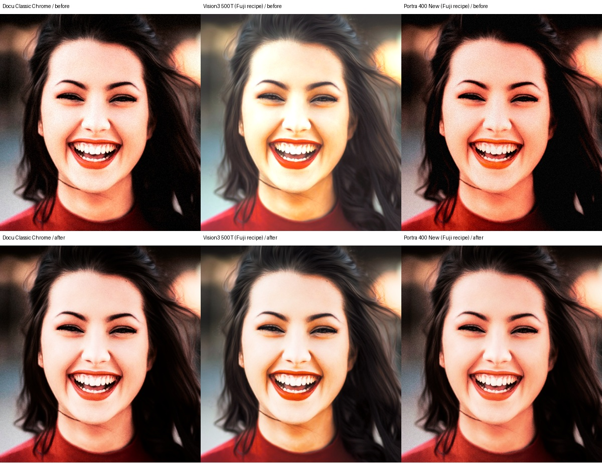
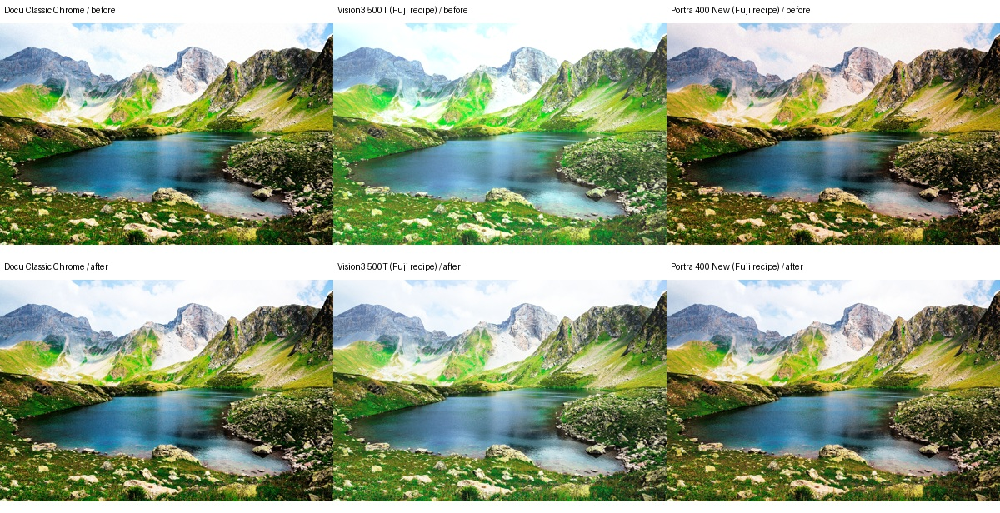

# Fuji still-photo rendering v1 — 2026-10-26

Baseline: `306ee16f23f929ad7230a0662e8b162770ae34a5`. The comparison uses fresh
CLI renders of the repository's two licensed public samples, not the older
round-1/2 contact sheets or stale thumbnails. Source/input/recipe/LUT/binary
hashes and settings: [manifest](fuji-photo-v1-manifest.json).

## Change and scope

The 204 imported Fuji camera-setting recipes opt into `fujiPhotoV1`:

- Display-sRGB WB uses a monotonic shoulder instead of allowing amplified
  channels to flatten at the LUT input clamp. This is an artistic JPEG WB
  adjustment, not a physically calibrated RAW white-balance transform.
- Tone has fixed black/white endpoints. Positive shadow deepens shadows;
  negative shadow opens them. The former additive lift inverted that intent.
  Highlight adjustments retain gradation instead of adding a constant near white.
- Saturation rolls gently toward the RGB gamut boundary, retaining chroma
  direction rather than hard-clipping individual channels.
- Deterministic monochrome grain scales with signal and channel headroom;
  it does not create new hard-clipped pixels from interior RGB values.

All official cubes, their strength=1 defaults, character bands, and existing
DeltaE goldens are unchanged. Non-opted recipes retain their legacy bytes;
five full-pipeline fixtures cover official Fuji, Kodak, CineStill, Ilford,
and the faded-warm custom example. CLI video, browser video posters, and
both browser video export routes explicitly retain legacy processing.

The 204 affected thumbnails and 11 official Fuji thumbnails were regenerated.
The generator now develops the full 1280x1920 sample before cropping/shrinking
to 420x280, so grain is no longer enlarged by developing a tiny crop first.
It supports explicit profile/brand/tier selection and `--force` regeneration.

## Pixel evidence

Top row is before, bottom row after. All full-image comparisons use unchanged
recipe strengths, authored grain and halation, native image resolution, and
the same display-sRGB cubes on both sides.





For the specific sample-1 face ROI `(420,370)-(820,790)`, measured with grain
disabled to isolate tone/WB, percentage of pixels with red >=254:

| Fuji recipe | Before | After |
|---|---:|---:|
| Docu Classic Chrome | 58.7810% | 2.4964% |
| Vision3 500T | 60.3655% | 1.8042% |
| Portra 400 New | 43.9268% | 0.1065% |

These are named Fuji community recipes, not the separate Kodak/CineStill
brand LUTs. This metric measures channel headroom, not recovered RAW detail,
skin accuracy, or universal image quality. The Python harness crops a Pillow
decoded JPEG; the Rust portrait test decodes via `image`/zune-jpeg and gives
slightly different counts, with the same improvement direction.

On sample-2 with authored grain, any-channel >=254 falls 10.72% -> 5.29%
(Docu), 24.72% -> 4.88% (Vision3), and 5.31% -> 2.52% (Portra). Portra's
all-channels <=4 falls 6.40% -> 1.89%, consistent with its negative-shadow
setting opening dark detail. Vision3's positive-shadow setting now deepens
shadows: its <=4 fraction rises 0% -> 0.33%. Less clipping is not itself
proof that every aesthetic change is preferable for every photograph.

## Verification and reproduction

```sh
# Baseline executable built before edits from the exact commit above:
cargo test --workspace --locked
cargo build -p openfuji-cli --locked
cp target/debug/openfuji /tmp/open-dazz-quality-306ee16/openfuji-before

# After changes:
cargo test --workspace --locked --offline
cargo build -p openfuji-cli --release --locked --offline
cargo build -p openfuji-wasm --release --target wasm32-unknown-unknown --locked --offline
wasm-bindgen target/wasm32-unknown-unknown/release/openfuji_wasm.wasm \
  --target bundler --out-dir web/src/pkg --out-name openfuji_wasm
python3 tools/verify_fuji_photo.py \
  --before /tmp/open-dazz-quality-306ee16/openfuji-before \
  --baseline-ref 306ee16 --after target/release/openfuji --check-wasm
python3 tools/make_thumbs.py --processing fujiPhotoV1 --force
python3 tools/make_thumbs.py --brand fuji --tier official --force
npm test --prefix web
npm run build --prefix web
git diff --check
```

Local results: **103 Rust tests passed**, one existing golden-blessing test
ignored; **2 browser-selection/serialization tests passed**; TypeScript and
production build passed. Seven new Rust tests cover all 81 tone combinations,
WB neutral/skin ramps, full real-LUT highlight ramps, actual portrait clipping,
grain bounds/determinism, profile coverage, and legacy byte regressions.
Every `(sim,patch)` golden row is now required exactly once; no golden was
re-blessed and no existing assertion was weakened.

The actual committed browser WASM matches native output byte-for-byte on
three face crops with authored grain and non-opaque alpha (maximum and mean
channel error both 0). `--check-wasm` invokes the committed bundler module
using Node's experimental WASM module loader, not a different test engine.

Strict `cargo clippy --workspace --offline -- -D warnings` **fails before and
after this change** on 12 existing warnings in unchanged `crates/ntsc-rs`.
Reproduced against a fresh `git archive 306ee16` in `/tmp`. Excluding vendor
linting exposes existing camcorder/CLI/WASM warnings too. A diagnostic run
excluding only those existing lint categories passes for the changed crates;
CI's strict check remains unchanged. No unrelated lint cleanup is included.
The added web CI job runs the two tests and production build independently.

## Limits

This demonstrates regression stability, reduced clipping on named inputs,
and inspected aesthetic improvements. It does **not** establish Fuji camera
fidelity: no matched RAF/SOOC-JPEG pairs or diverse portrait corpus exist yet.
Imported red/blue camera WB axes are still approximated by temp/tint. Fixed
halation size, grain size across arbitrary export resolutions, and broader
skin/illumination testing remain future work. Historic verification reports
describe earlier LUT revisions; deployment version is a separate concern.
